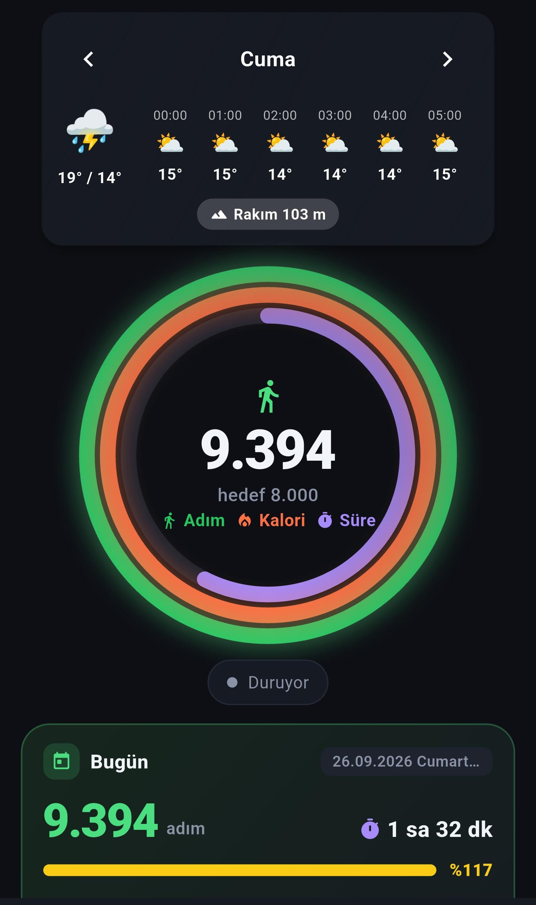
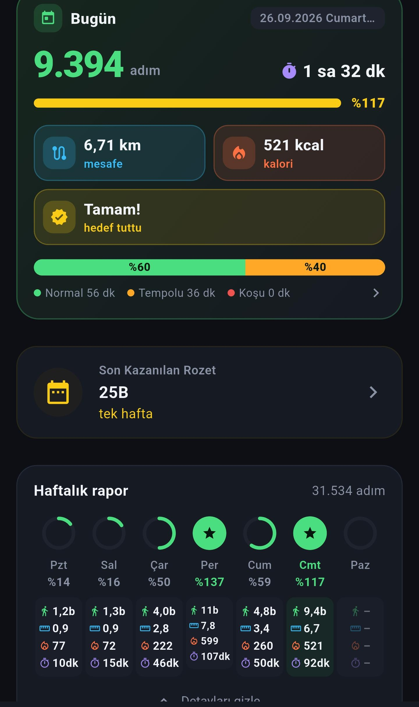
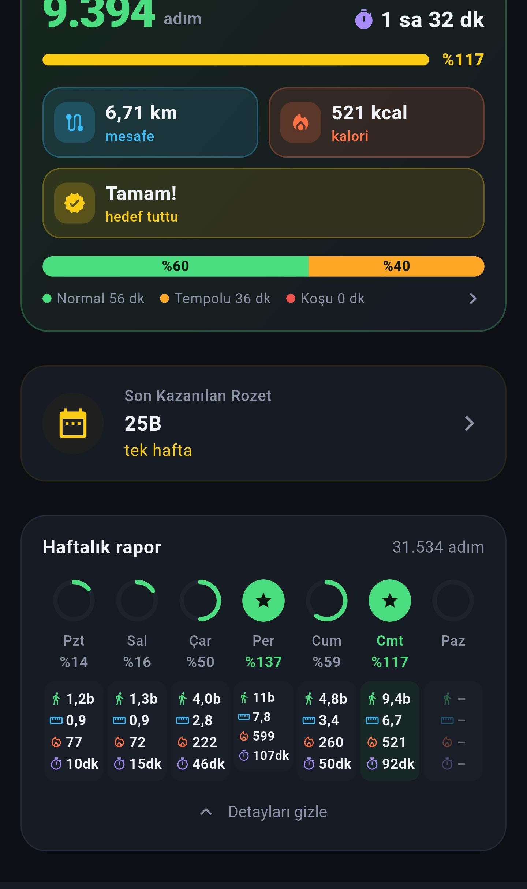
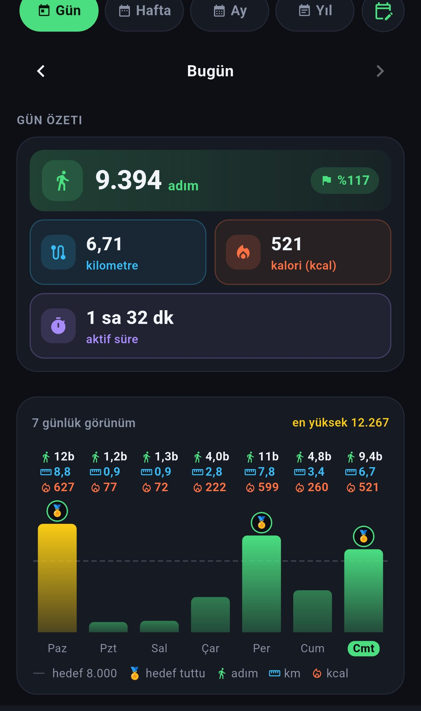
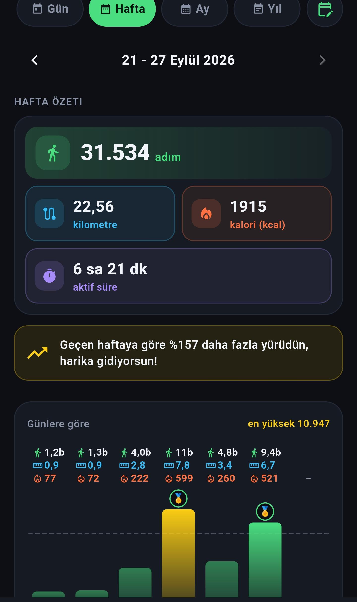
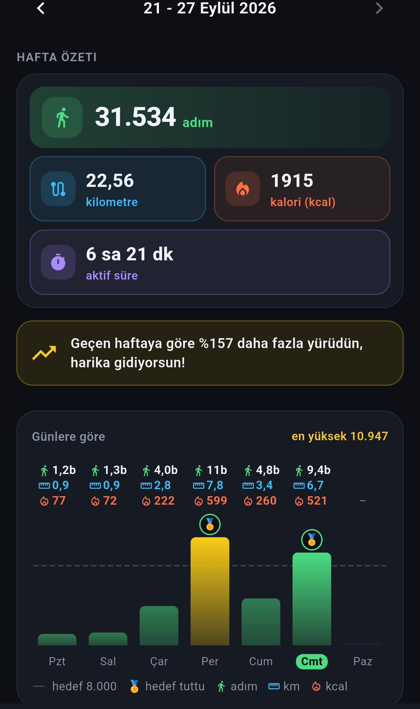
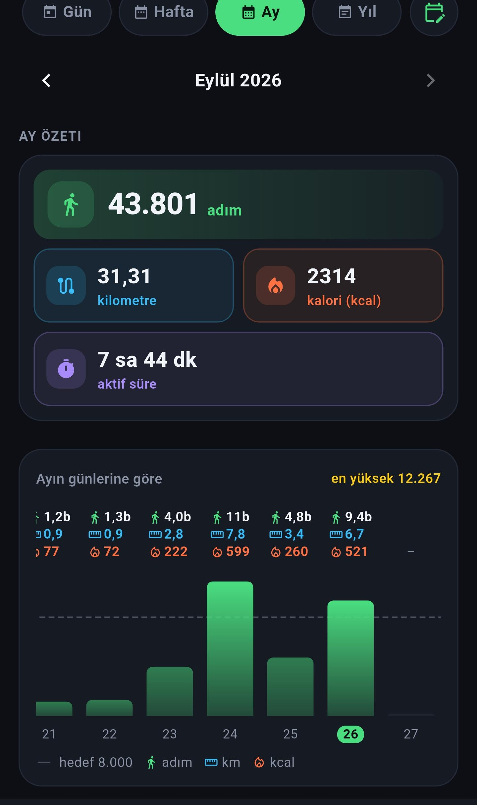
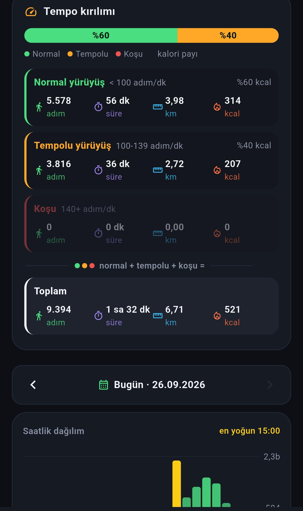

# Yürüyüş Defteri 🚶‍♂️

Yürüyüş Defteri, açık kaynaklı, reklamsız ve gizliliğe önem veren, tamamen kullanıcı odaklı bir sağlık ve aktivite takip uygulamasıdır. Günlük adımlarınızı saymanın ötesinde, yürüyüş rotalarınızı harita üzerinde canlı olarak çizer, su ve kilo takibinizi yapar, geçmiş verilerinizi ısı haritaları (heatmap) ve detaylı grafiklerle analiz eder.

Uygulama, hem yerel cihaz sensörlerini hem de bulut tabanlı (Firebase) veri senkronizasyonunu birleştirerek modern bir sağlık asistanı deneyimi sunar.

---

## 🌟 Öne Çıkan Özellikler ve Sayfalar

### 1. Ana Ekran ve Adım Takibi
- **Sensör Tabanlı Hassas Ölçüm:** Cihazın yerleşik pedometre sensörlerini kullanarak düşük pil tüketimiyle sürekli adım takibi yapar.
- **Gerçek Zamanlı Metrikler:** Atılan adımlara göre anlık mesafe (km/m), yakılan kalori (kcal) ve aktif süre hesaplanır.
- **Hedef Takibi:** Günlük adım hedefinizi dairesel ilerleme çubukları ve motive edici görsel geri bildirimlerle gösterir.

<p align="center">
  
  
</p>

### 2. Canlı Rota Takibi
- **GPS ve Harita Entegrasyonu:** `flutter_map` (OpenStreetMap tabanlı) ve `geolocator` kullanarak anlık konumunuzu haritada gösterir.
- **Canlı Rota Çizimi:** Yürüyüş, koşu veya bisiklet aktiviteleriniz sırasında geçtiğiniz yolları gerçek zamanlı olarak (Polyline) çizer.
- **Hava Durumu:** Aktivite esnasında bölgesel hava durumu verisini anlık olarak yansıtır (`weather_service.dart`).
- **Aktivite Kaydı:** Tamamlanan rotalar süre, ortalama hız ve katedilen mesafe ile birlikte cihaz hafızasına ve buluta kaydedilir.

<p align="center">
  
  
</p>

### 3. Gelişmiş İstatistikler ve Analizler
- **Isı Haritası:** GitHub benzeri bir contribution (katkı) takvimi ile yıl içindeki aktivite yoğunluğunuzu görselleştirir.
- **Detaylı Analiz:** Haftalık, aylık ve yıllık bazda adım, mesafe ve yakılan kalori trendlerinizi grafiklerle sunar. Ortalama aktivite düzeyinizi analiz eder.
- **Geçmiş Günlükler:** Geçmişe dönük tüm aktivitelerinizi ve günlük özetlerinizi listeler.

<p align="center">
  
  
</p>

### 4. Sağlık ve Beslenme Takibi
- **Su Tüketimi:** Günlük su içme hedefinizi belirler, her bardak su içtiğinizde hızlıca kayıt almanızı sağlar. Animasyonlu sıvı dolum efektleriyle motivasyonu artırır.
- **Kilo Takibi:** Düzenli kilo girişleri ile form grafiğinizi takip etmenize olanak tanır.

<p align="center">
  
</p>

### 5. Kimlik Doğrulama ve Bulut Yedekleme
- **Çoklu Giriş Yöntemleri:** `email_auth`, `phone_auth` ve Google Sign-in seçenekleriyle Firebase Authentication üzerinden güvenli oturum açma imkanı sunar.
- **Bulut Senkronizasyonu:** Tüm yürüyüş, su, kilo ve ayar verileriniz güvenli bir şekilde Firestore'a senkronize edilir.

### 6. Arka Plan Hizmetleri ve Bildirimler
- **Foreground Service:** Uygulama kapalıyken bile adımlarınızın hatasız sayılmaya devam etmesini sağlayan Android ön plan servisi altyapısı.
- **Bildirimler:** Günlük adım ve su hedeflerinize ulaştığınızda yerel bildirimlerle (Local Notifications) sizi tebrik eder.
- **Ana Ekran Widget'ı:** Uygulamaya girmeden anlık adım sayınızı cihazınızın ana ekranından takip edebileceğiniz iOS/Android Home Widget desteği.

<p align="center">
  
</p>

---

## 🛠 Teknik Mimari ve Kullanılan Teknolojiler

Bu proje **Flutter** ile geliştirilmiş olup temiz mimari (Clean Architecture) prensiplerine ve durum yönetimi standartlarına uygun olarak tasarlanmıştır.

- **Durum Yönetimi (State Management):** Uygulama genelinde verimli ve reaktif bir veri akışı için `Provider` kullanılmıştır.
- **Veritabanı ve Kimlik Doğrulama:** Google Firebase (Auth & Cloud Firestore).
- **Harita ve Konum:** `flutter_map`, `latlong2`, `geolocator`.
- **Donanım ve Sensör Erişimi:** `pedometer` (adım sensörü), `permission_handler` (izin yönetimi).
- **UI & Animasyonlar:** `lottie` (vektörel animasyonlar), `confetti` (kutlama efektleri), `percent_indicator` (ilerleme çubukları), `shimmer` (yükleme efektleri).
- **Arka Plan İşlemleri:** `flutter_local_notifications`, yerel hizmetler ve ana ekran eklentileri (`home_widget`).

---

## 🚀 Başlangıç ve Kurulum

Bu projeyi geliştirme ortamınızda çalıştırmak için aşağıdaki adımları izleyebilirsiniz.

1. **Depoyu Klonlayın:**
   ```bash
   git clone https://github.com/ismailsoylemez-dev/yuruyus_defteri.git
   cd yuruyus_defteri
   ```

2. **Bağımlılıkları Yükleyin:**
   ```bash
   flutter pub get
   ```

3. **Firebase Yapılandırması:**
   Uygulamanın çalışması için kendi Firebase projenizi bağlamanız gereklidir.
   - Proje dizininde yer alan `FIREBASE_KURULUM.md` dosyasındaki talimatları takip edin.

4. **Uygulamayı Çalıştırın:**
   ```bash
   flutter run
   ```

---

## 📜 Lisans

Bu proje, açık kaynak topluluğuna katkı sağlamak amacıyla geliştirilmiştir.
