<p align="center">
  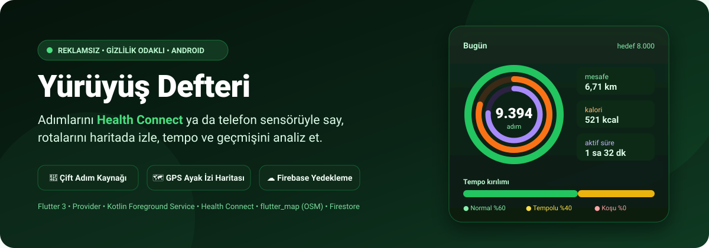
</p>

<p align="center">
  
  
  
  
  
  
</p>

# Yürüyüş Defteri

**Yürüyüş Defteri**, piyasadaki reklamlı adım sayarlara alternatif olarak geliştirilmiş; **reklamsız**, **gizlilik odaklı** ve tamamen kullanıcıya hizmet eden bir Android adım sayar ve yürüyüş takip uygulamasıdır. Adımları **Health Connect** üzerinden ya da doğrudan telefonun **adım sensöründen** sayar, yürüdüğün yolları **harita üzerinde ayak izi** olarak çizer, yürüyüşünü **normal / tempolu / koşu** olarak ayrıştırır ve tüm verini **Google hesabınla Firebase'e** yedekler.

- 👣 **Çift Adım Kaynağı (Health Connect ↔ Sensör):** Ayarlar'dan adım kaynağı seçilir; ikisi aynı anda aktif olmaz, aynı zaman dilimi iki kez **toplanmaz**. Mod geçmişi cihaz bazlı tutulur, geçiş günü her dilim kendi kaynağından okunur; geçiş sırasında günlük adım **asla düşürülmez** ("büyük olan kazanır").
- 🔋 **Kesintisiz Arka Plan Sayımı (`StepService` Foreground Service):** Kotlin ön plan servisi (`health|location`) uygulama kapalıyken de çalışır. Sensör modunda `TYPE_STEP_COUNTER` ile sayar, Health Connect modunda pasif kipte kalıcı bildirim ve otomatik iz için çalışır. Cihaz yeniden başlatıldığında `BootReceiver` servisi geri getirir.
- 🗺️ **Hibrit GPS ile Otomatik Ayak İzi:** Boştayken konum **hiç istenmez**. Son 60 sn kadans yürüme eşiğini geçince GPS yüksek doğrulukta açılır, 4 dk hareketsizlikte kapanır. Günün tüm yürüyüşleri harita üzerinde **normal / tempolu / koşu** renkleriyle, yıl boyu yürünen yollar ise **ısı haritası** olarak görünür.
- 🏃 **Antrenman Modu (Dış Mekân / İç Mekân):** Dış mekânda GPS her zaman yüksek doğrulukta; doğruluk filtresi (ilk 30 sn ≤25 m, sonra ≤30 m), 12 m/s üstü **sıçrama eleme** ve dinamik minimum hareket mesafesi ile temiz rota. GPS açılamazsa "İç mekânda başlat" seçeneği; iç mekânda mesafe adımdan tahmin edilir ve açıkça etiketlenir.
- 📊 **Tempo Kırılımı ve Detaylı Analiz:** Dakika kovalarıyla yürüyüş temposu sınıflanır (30 / 100 / 140 / 230 adım/dk eşikleri). Saatlik dağılım, gün / hafta / ay / yıl özetleri, geçen döneme göre kıyas, fitness halkaları (adım, kalori, süre) ve GitHub tarzı yıllık ısı takvimi.
- 📏 **Kişisel Adım Boyu Kalibrasyonu:** Başlangıçta boy × 0,415 tahmini kullanılır; 5 dış mekân GPS yürüyüşünden sonra adım boyu otomatik kalibre edilir (0,45–0,82 m, tahminin ±%20'si güvenlik kapısıyla). Kotlin ve Dart formülleri birebir aynıdır (`Formulas.kt` ↔ `metrics.dart`).
- 🏅 **Rozetler, Rekorlar ve İçgörüler:** Mesafe ve adım rozetleri, en uzun seri, tüm zamanlar kartı, haftalık rapor ve hedefe ulaşıldığında günde bir kez konfeti. Bir kez kazanılan rozet **kaybolmaz** (yerel ∪ bulut birleşimi).
- 💧 **Su, Kilo ve Hava Önerisi:** İsteğe bağlı su ve kilo takibi, saatlik hava durumuna göre yürüyüş önerisi (Open-Meteo).
- 📱 **Ana Ekran Widget'ı, Hızlı Ayar Kutusu ve Bildirimler:** Uygulamayı açmadan adım ve km takibi, bildirim çekmecesinden tek dokunuşla antrenman başlatma, hedef / akşam hatırlatması / haftalık özet / hareketsizlik uyarıları.
- ☁️ **Google ile Giriş ve Bulut Yedekleme:** Firebase Auth + Cloud Firestore; günlük özetler, saatlik adımlar ve tempo verisi tek yazıcı (`pull → merge → push`) üzerinden senkronlanır. Telefon değiştirdiğinde veriler geri gelir.

---

## Ekran Görünümleri

Uygulamanın gerçek cihazda (Xiaomi, koyu tema) alınmış ekran görüntüleri:

<p align="center">
  
  
  
  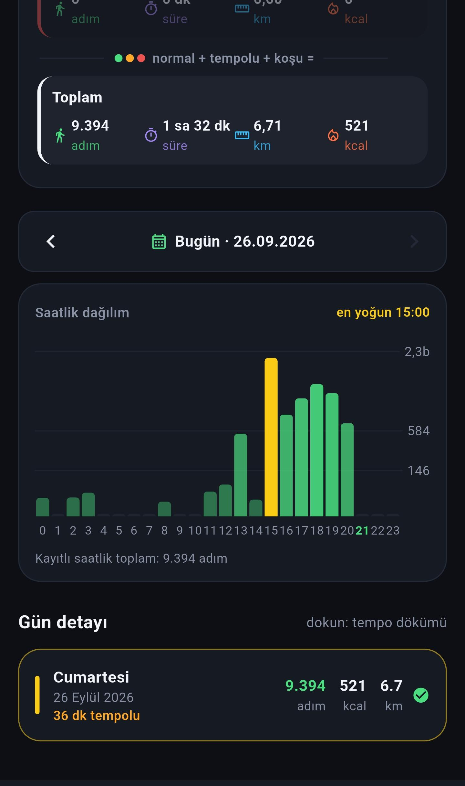
</p>

<p align="center">
  
  
  
  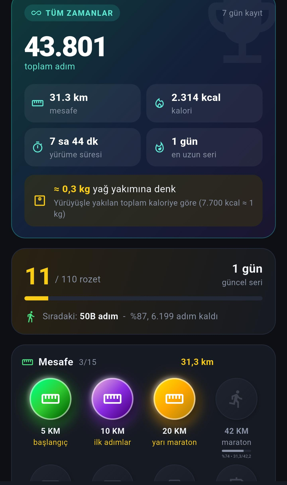
</p>

<p align="center">
  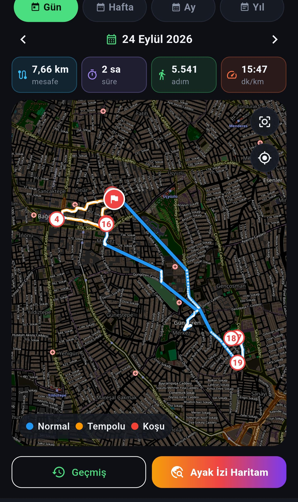
  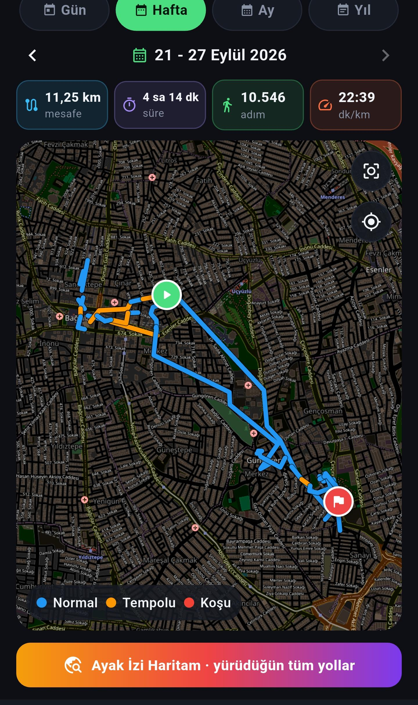
  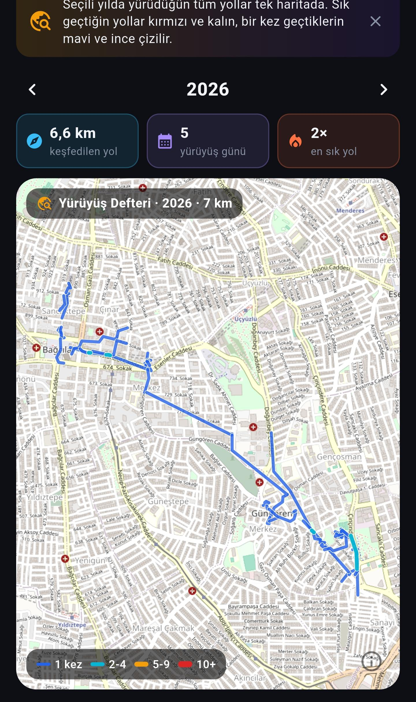
  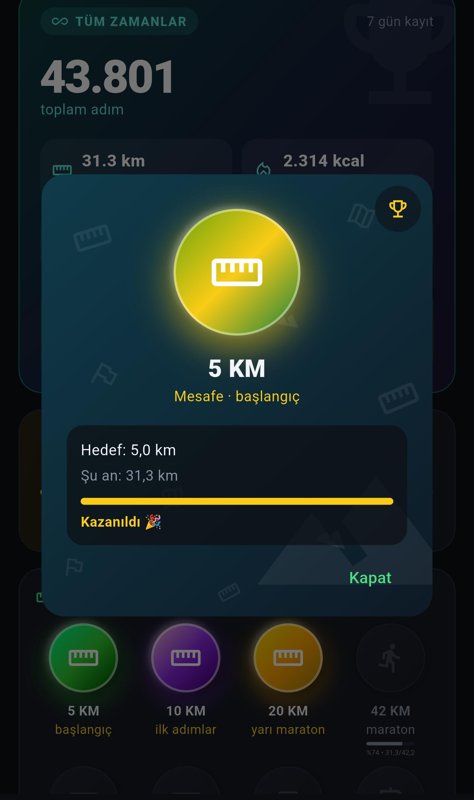
</p>

<details>
<summary><b>Ayarlar ekranları</b></summary>
<p align="center">
  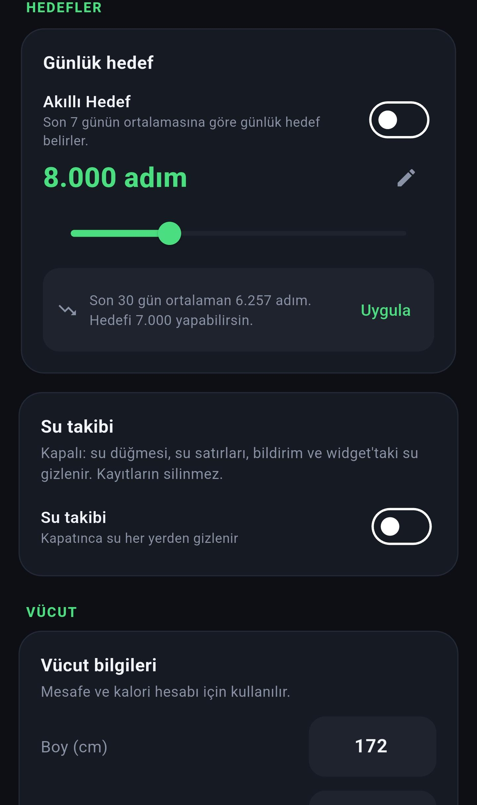
  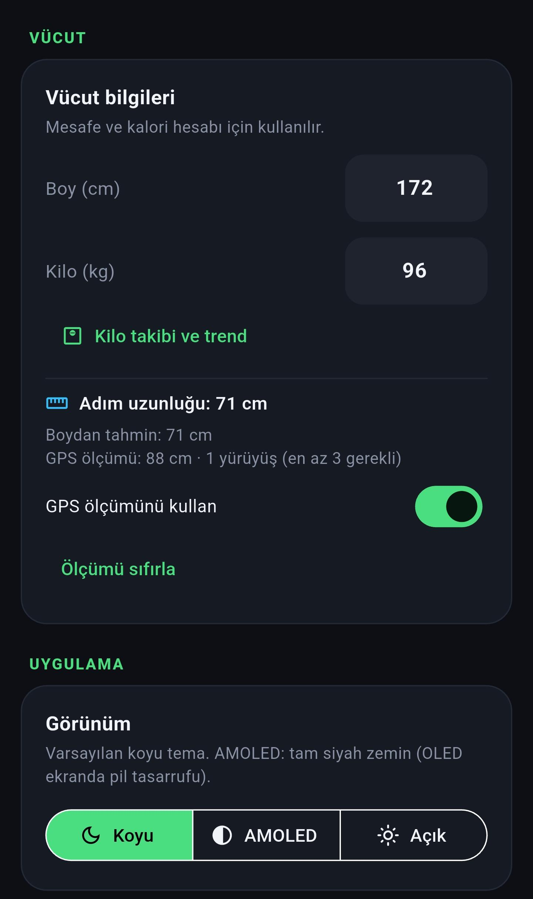
  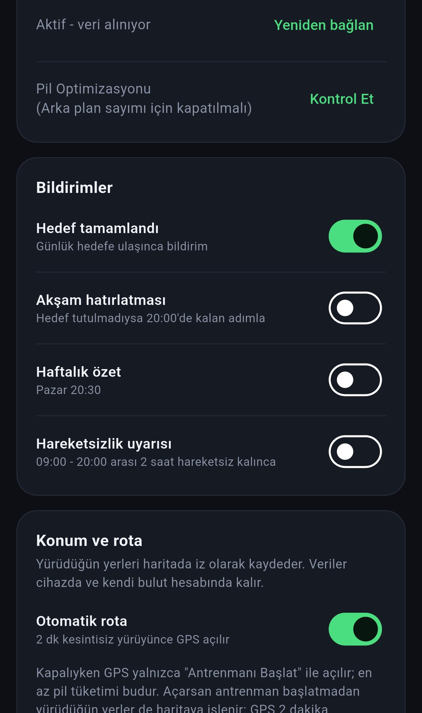
  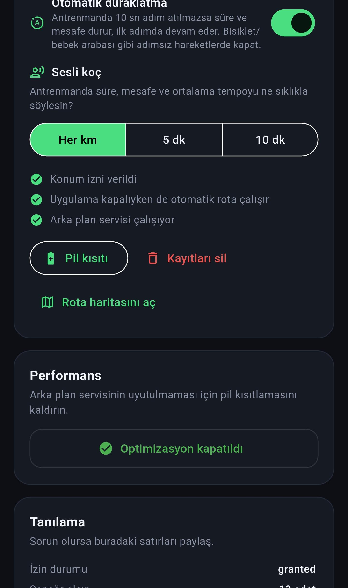
</p>
<p align="center">
  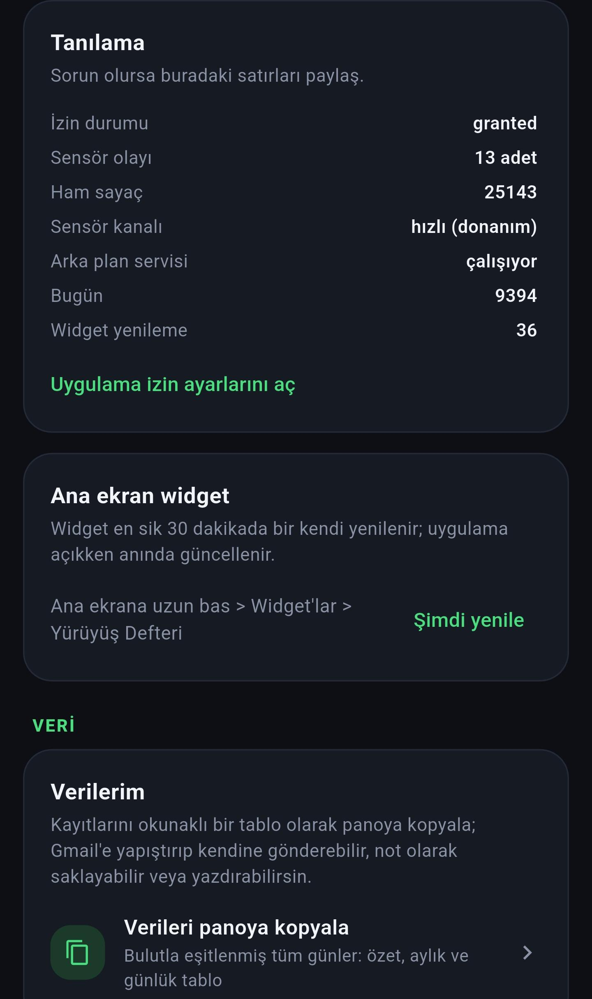
  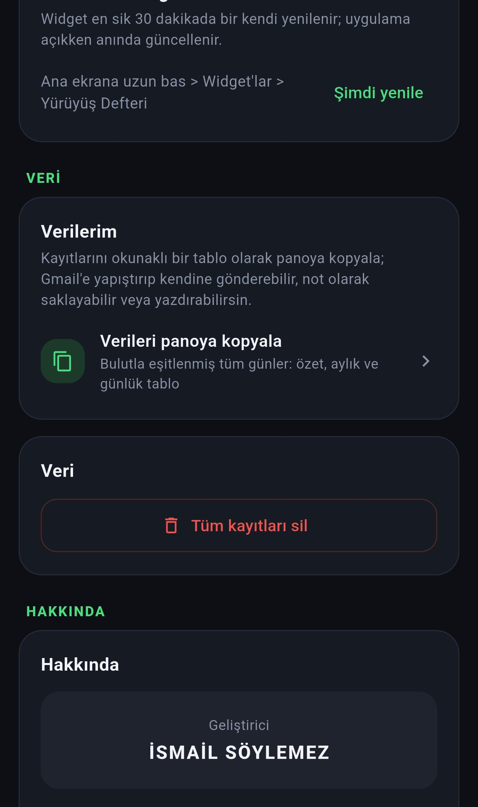
</p>
</details>

| Ekran | Öne Çıkan Özellikler |
|---|---|
| **Bugün (`HomeScreen`)** | Adım / kalori / süre fitness halkaları, günlük hedef yüzdesi, km ve kcal kartları, tempo kırılımı çubuğu, saatlik hava durumu ve rakım, son kazanılan rozet, haftalık rapor. |
| **Geçmiş (`HistoryScreen`)** | Gün / Hafta / Ay / Yıl sekmeleri, dönem özeti, geçen döneme göre kıyas ("geçen haftaya göre %157 daha fazla"), günlere göre grafik, gün detayı ve tempo dökümü. |
| **Rota (`RouteScreen`)** | Günlük ve haftalık ayak izi, tempo renkli rota çizgisi, antrenman başlat (dış / iç mekân), rota istatistikleri ve paylaşım kartı. |
| **Isı Haritası (`HeatmapScreen`)** | Yıl boyunca yürünen yolların yoğunluk haritası (1×, 2-4, 5-9, 10+), ev konumu için gizlilik maskesi. |
| **İçgörüler & Rozetler (`InsightsScreen`, `AchievementsScreen`)** | Tüm zamanlar kartı, en uzun seri, mesafe / adım rozetleri, rekorlar. |
| **Ayarlar (`SettingsScreen`)** | Adım kaynağı seçimi, akıllı hedef, su / kilo takibi, boy-kilo ve adım boyu kalibrasyonu, tema (Koyu / AMOLED / Açık), bildirimler, otomatik rota, pil optimizasyonu, tanılama, widget ve veri dışa aktarma. |

---

## Nasıl Çalışır?

<p align="center">
  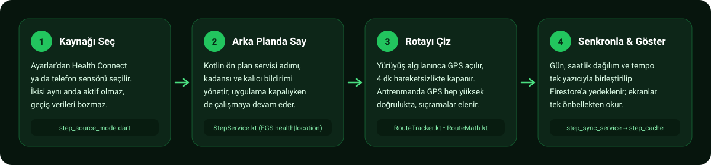
</p>

1. **Adım Kaynağı Seçimi (`step_source_mode.dart`)** — İlk açılışta ya da Ayarlar'dan **Health Connect** veya **telefon sensörü** seçilir. Geçiş tek bir atomik işlemle kaydedilir; o andan sonraki dilim yeni kaynaktan okunur.
2. **Arka Plan Sayımı (`StepService.kt`)** — Ön plan servisi seçilen kipe göre çalışır: sensör modunda adımları sayıp geçmişe yazar, Health Connect modunda adımlar uygulama ön plandayken Health Connect'ten okunur, servis ise kalıcı bildirim, kadans ve otomatik iz için çalışır. Kip değişikliği servisi yeniden başlatmadan **yerinde** uygulanır.
3. **Rota ve Ayak İzi (`RouteTracker.kt` + `RouteMath.kt`)** — Adım dedektörü yürüyüş algılayınca GPS yüksek doğrulukta açılır, 4 dk yürüyüş yoksa kapanır; 30 sn'lik kısa duraklamalar izi bozmaz. Konum kapalıyken yürüyüş algılanırsa "konumu aç" bildirimi gelir (2 saatte en fazla 1).
4. **Senkron ve Gösterim (`step_sync_service.dart` → `step_cache.dart`)** — Günlük toplamlar, saatlik adımlar ve tempo verisi tek yazıcıyla Firestore'dan çekilir, birleştirilir ve geri yazılır. Tüm ekranlar yalnızca `StepCache`'ten okur; böylece ana ekran, bildirim ve widget hep aynı sayıyı gösterir.

---

## Teknik Mimari

<p align="center">
  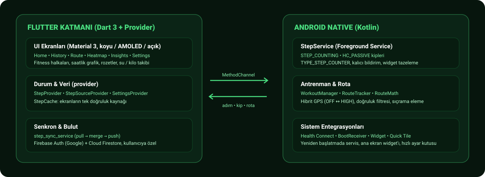
</p>

Uygulama, Flutter UI / durum katmanı ve Android Native (Kotlin) arka plan motoru olarak iki ana katmandan oluşur:

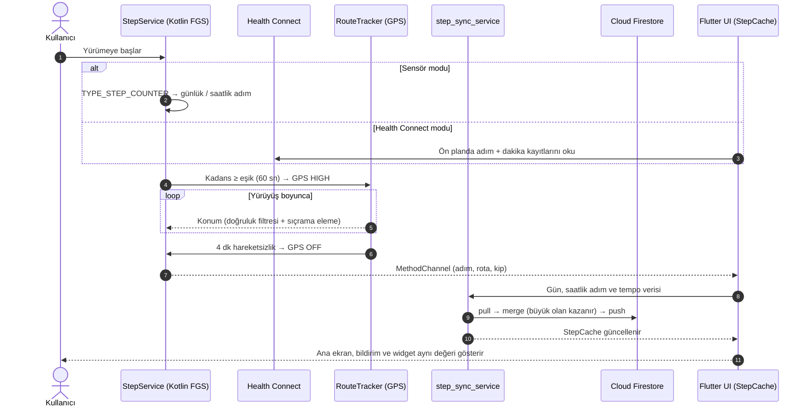

### Katman ve Sorumluluk Tablosu

| Katman | Dosya / Sınıf | Sorumluluk |
|---|---|---|
| **Flutter UI** | `lib/screens/home_screen.dart` | Fitness halkaları, günlük metrik kartları, tempo kırılımı, hava önerisi. |
| **Flutter UI** | `lib/screens/history_screen.dart` | Gün / hafta / ay / yıl geçmişi, dönem kıyası, gün detayı. |
| **Flutter UI** | `lib/screens/route_screen.dart` | Ayak izi haritası (`flutter_map` + OSM), antrenman başlatma, rota istatistikleri. |
| **Flutter UI** | `lib/screens/settings_screen.dart` | Adım kaynağı, hedefler, kalibrasyon, tema, bildirimler, tanılama, veri. |
| **State** | `lib/providers/step_provider.dart` | UI durumu, widget / bildirim tazeleme, hedef kutlaması. |
| **State** | `lib/providers/step_source_provider.dart` | Health Connect ↔ sensör geçişi, HC izin durumu, bildirim planı. |
| **Veri & Senkron** | `lib/services/steps/step_sync_service.dart` | Günlük, saatlik ve tempo verisi için tek yazıcı (`pull → merge → push`). |
| **Veri & Senkron** | `lib/services/steps/step_cache.dart` | Ekranların tek doğruluk kaynağı. |
| **Veri & Senkron** | `lib/services/steps/health_connect_step_source.dart` | Health Connect okuma, dakika kovaları ve tempo sınıflama (`hc_intensity.dart`). |
| **Bulut** | `lib/services/cloud_service.dart`, `cloud_write.dart`, `auth_service.dart` | Google girişi, Firestore okuma / yazma (debug build'de yazma kilidi). |
| **Android Native** | `StepService.kt` | Ön plan servisi, `STEP_COUNTING` / `HC_PASSIVE` kipleri, kalıcı bildirim. |
| **Android Native** | `RouteTracker.kt`, `RouteMath.kt` | Konum takibi, doğruluk filtresi, hibrit GPS geçişleri (saf, birim testli). |
| **Android Native** | `WorkoutManager.kt`, `WorkoutTileService.kt` | Dış / iç mekân antrenman yaşam döngüsü, hızlı ayar kutusu. |
| **Android Native** | `StepWidgetProvider.kt`, `WidgetRenderer.kt`, `BootReceiver.kt` | Ana ekran widget'ı ve yeniden başlatma sonrası servis. |
| **Android Native** | `Formulas.kt` | Dart `Metrics` formüllerinin birebir Kotlin karşılığı (km, kcal, tempo). |

---

## Proje Dizin Yapısı

```text
yuruyus_defteri/
├── android/app/src/
│   ├── main/kotlin/com/ismail/adim_sayar/
│   │   ├── MainActivity.kt          # MethodChannel köprüsü, bildirim kanalları, konum açma isteği
│   │   ├── StepService.kt           # Ön plan servisi (sensör / HC pasif kip), bildirim
│   │   ├── RouteTracker.kt          # Konum takibi, filtre, hibrit GPS
│   │   ├── RouteMath.kt             # Saf matematik: isJump, minMove, nextAccuracy
│   │   ├── WorkoutManager.kt        # Antrenman yaşam döngüsü
│   │   ├── Formulas.kt              # Dart metrics.dart ile birebir formüller
│   │   ├── BootReceiver.kt          # Yeniden başlatmada servis
│   │   ├── ServiceWatchdogReceiver.kt
│   │   ├── StepWidgetProvider.kt    # Ana ekran widget'ı
│   │   ├── WidgetRenderer.kt
│   │   └── WorkoutTileService.kt    # Hızlı ayar kutusu
│   └── test/kotlin/RouteMathTest.kt
├── lib/
│   ├── main.dart
│   ├── providers/                   # step_provider, step_source_provider, settings_provider
│   ├── screens/                     # home, history, route, heatmap, insights, achievements, settings…
│   ├── services/
│   │   ├── steps/                   # step_sync_service, step_cache, step_source_mode, health_connect_step_source…
│   │   ├── route_service.dart       # Workout modeli, rota / ısı haritası
│   │   ├── cloud_service.dart       # Firestore okuma
│   │   ├── auth_service.dart        # Google ile giriş
│   │   └── weather_service.dart     # Open-Meteo hava durumu
│   ├── widgets/                     # fitness_rings, activity_sheet, year_heatmap, period_chart…
│   └── utils/                       # metrics, intensity, aggregate, achievements, records
├── test/                            # 43 dosya, ~760 birim testi
├── screenshots/                     # Cihaz ekran görüntüleri
├── docs/images/                     # README görselleri
└── firestore.rules                  # Kullanıcı yalnızca kendi verisine erişir
```

---

## Kurulum ve Derleme

### Gereksinimler
- **Flutter SDK:** Dart `>=3.6.0`
- **Hedef Platform:** Android (`minSdk = 26`, `targetSdk = 35`, `compileSdk = 36`)
- **Firebase:** Kendi Firebase projen ve `android/app/google-services.json` dosyası. Ayrıntılar için [`FIREBASE_KURULUM.md`](FIREBASE_KURULUM.md).

### Komutlar

```powershell
# Depoyu klonlayın
git clone https://github.com/ismailsoylemez-dev/yuruyus_defteri.git
cd yuruyus_defteri

# Bağımlılıkları yükleyin
flutter pub get

# Statik kod analizi ve testleri çalıştırın
flutter analyze
flutter test

# Kotlin derleme ve birim testleri
cd android; .\gradlew.bat :app:compileDebugKotlin :app:testDebugUnitTest; cd ..

# Debug APK derlemesi
flutter build apk --debug

# Release APK derlemesi
flutter build apk --release
```

> **Not:** Debug build'ler Firestore'a **yazmaz** (yalnızca okur); bulut yazma yalnızca release build'de açıktır.

---

## İzinler ve Gizlilik

- `ACTIVITY_RECOGNITION`: Telefonun adım sensörüne erişmek için.
- `health.READ_STEPS`: Health Connect modunda adımları okumak için. Uygulama Health Connect'e **hiçbir veri yazmaz**, arka plan okuma izni istemez.
- `ACCESS_FINE_LOCATION` / `ACCESS_COARSE_LOCATION`: Antrenman rotası ve ayak izi için.
- `ACCESS_BACKGROUND_LOCATION`: Otomatik ayak izinin uygulama kapalıyken çalışabilmesi için (Ayarlar'dan kapatılabilir).
- `FOREGROUND_SERVICE`, `FOREGROUND_SERVICE_HEALTH`, `FOREGROUND_SERVICE_LOCATION`: Adım sayımı ve rota takibinin Android tarafından sonlandırılmaması için.
- `POST_NOTIFICATIONS`, `VIBRATE`: Kalıcı adım bildirimi, hedef ve hatırlatma bildirimleri için.
- `RECEIVE_BOOT_COMPLETED`, `WAKE_LOCK`: Cihaz yeniden başladığında servisin geri gelmesi için.
- `REQUEST_IGNORE_BATTERY_OPTIMIZATIONS`: Xiaomi (MIUI/HyperOS) gibi agresif pil yönetimi olan cihazlarda sayımın kesilmemesi için.
- `INTERNET`: Firebase senkronu, harita karoları (OpenStreetMap) ve hava durumu (Open-Meteo) için.
- **Gizlilik:** Uygulamada **reklam ve analitik SDK'sı yoktur**. Bulut verisi Firestore kuralları gereği yalnızca hesabın sahibi tarafından okunup yazılabilir (`request.auth.uid == uid`). Isı haritasında ev konumu çevresi gizlilik maskesiyle gizlenebilir. Konum, yalnızca hava durumu sorgusu için Open-Meteo'ya gönderilir.
